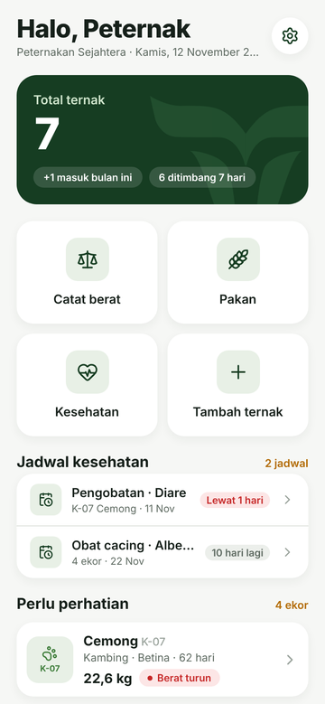
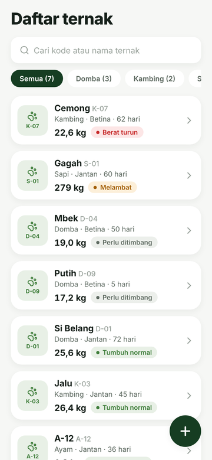
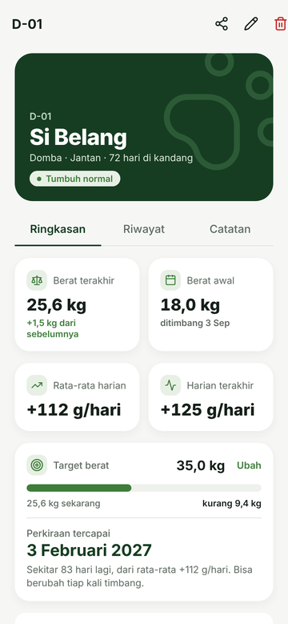
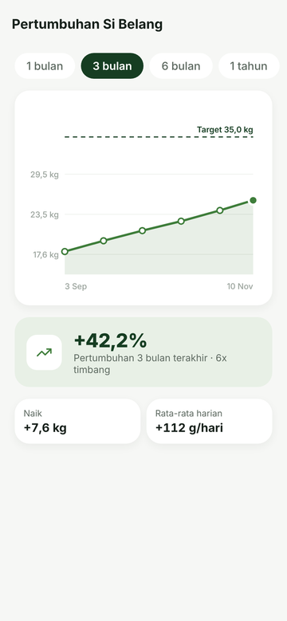
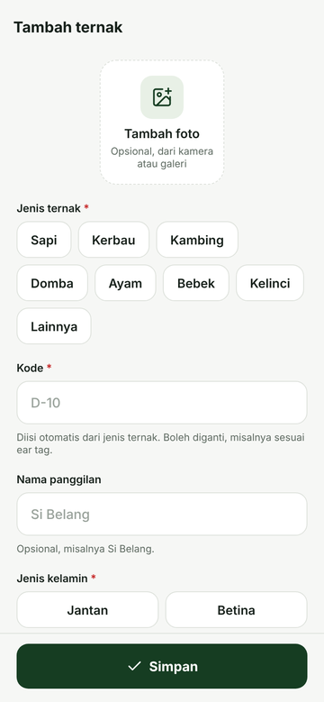
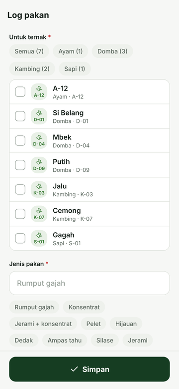
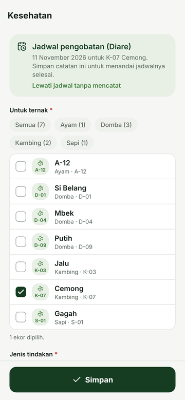
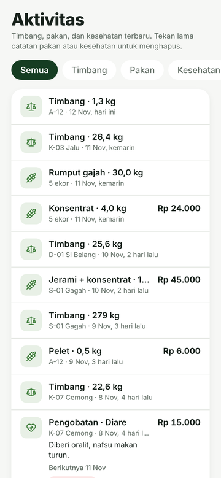
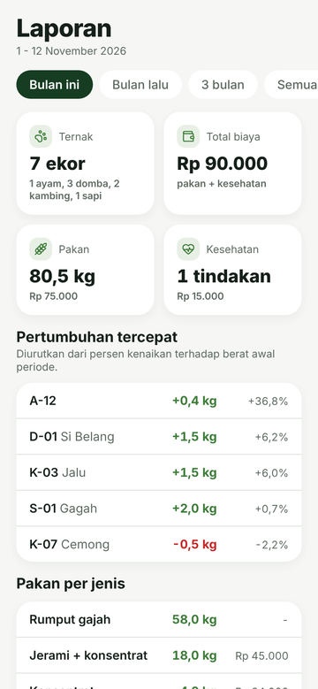
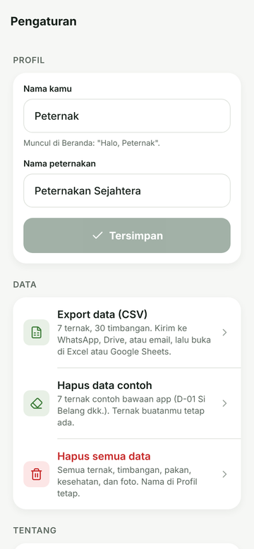

# TERNAK: Livestock Management

Aplikasi React Native (Expo) untuk peternak kecil: daftar ternak, catatan timbang, **grafik pertumbuhan berat per ekor** dengan pertambahan bobot harian (ADG), target berat dan perkiraan tanggal tercapai, log pakan, catatan kesehatan dengan jadwal berikutnya, serta laporan PDF. Ternak yang beratnya turun, pertumbuhannya melambat, atau sudah lama nggak ditimbang otomatis ditandai. Berlaku untuk semua jenis ternak, satuan kg. Dibuat sebagai latihan Mobile Programming Native.

Data tersimpan di HP (SQLite) dan aplikasi jalan tanpa internet. Saat pertama kali dibuka, database diisi 7 ternak contoh yang bisa dihapus dari Pengaturan.

## Tampilan

| | | | | |
| :---: | :---: | :---: | :---: | :---: |
|  |  |  |  |  |
| Beranda | Daftar ternak | Detail ternak | Pertumbuhan | Tambah ternak |
|  |  |  |  |  |
| Log pakan | Kesehatan | Aktivitas | Laporan | Pengaturan |

Screenshot diambil dari pratinjau web dengan data contoh, jadi tab bar bawah tidak terlihat.

## Design system (dikunci)

Semua halaman mengikuti aturan ini, didefinisikan di `src/constants/theme.ts`.

| Warna | Hex | Dipakai untuk |
| --- | --- | --- |
| Hijau tua | `#163D22` | Tombol utama, pil aktif, kartu hero, tab aktif |
| Hijau | `#3E7D3A` | Ikon, grafik, angka naik |
| Hijau muda | `#E8F0E6` | Latar ikon dan pil |
| Abu | `#DDE1DB` | Garis dan pemisah |

- Logo: `assets/brand/ternak-logo.svg`, dipakai di splash, ikon app, dan lewat komponen `Logo` di dalam app.
- Font: **Inter** (Regular, Medium, SemiBold, Bold, ExtraBold).
- Kartu putih, sudut membulat 20, bayangan halus.
- Warna lain (kuning, merah, abu) hanya untuk status pertumbuhan.

Animasi:
- Grafik pertumbuhan **tergambar** dari kiri ke kanan.
- Angka berat dan statistik **menghitung naik** dari 0.
- Kartu **muncul berurutan** dengan efek halus.

Semua animasi otomatis dilewati kalau pengaturan "kurangi gerakan" di HP menyala (`useReducedMotion`).

## Cara menjalankan

Syarat: Node.js (LTS) di laptop, dan aplikasi **Expo Go versi terbaru** di HP Android (project ini pakai Expo SDK 58). HP dan laptop harus tersambung ke Wi-Fi yang sama.

```bash
git clone https://github.com/primappratama/ternak.git
cd ternak
npm install
npx expo start
```

Lalu scan QR yang muncul di terminal pakai Expo Go. Kalau HP nggak bisa nyambung, pakai `npx expo start --tunnel`.

Cek tipe sebelum commit: `npx tsc --noEmit`

## Penyimpanan data

- Di HP: SQLite (`src/data/repository.native.ts`), file `ternak.db` dengan tabel `animals`, `weights`, `feeds` + `feed_animals`, `health` + `health_animals`, dan `settings` (nama kamu dan nama peternakan). Satu catatan pakan/kesehatan bisa untuk beberapa ekor lewat tabel `*_animals`. Kolom yang ditambah belakangan (misalnya `target_kg`) dipasang otomatis lewat `ALTER TABLE` saat app dibuka, tanpa menghapus data lama. Foto ternak disalin ke folder `photos` milik app, database hanya menyimpan alamatnya.
- Di browser (pratinjau): disimpan di memori (`src/data/repository.ts`), hilang saat halaman dimuat ulang.
- Semua halaman membaca data dari `LivestockProvider` (`src/data/livestock-store.tsx`), jadi perubahan langsung terlihat di semua halaman.
- Untuk mulai dari data kosong: buka Pengaturan (ikon gerigi di Beranda), lalu **Hapus data contoh** (hanya 7 ternak bawaan) atau **Hapus semua data**.
- Cadangan: Pengaturan > **Export data (CSV)**. Satu baris per timbangan, bisa dikirim ke WhatsApp/Drive dan dibuka di Excel atau Google Sheets. Ini salinan untuk dibaca, belum bisa diimpor balik ke app.
- Data hanya ada di HP itu. Kalau Expo Go atau datanya dihapus, data ikut hilang.

## Pengaman input

- Kode ternak diusulkan otomatis per jenis (misalnya `D-10`), wajib unik (juga saat diedit).
- Saat edit, tanggal masuk nggak boleh setelah timbangan pertama. Kalau timbangan pertama dibuat bareng ternaknya (berat awal), timbangan itu ikut pindah ke tanggal masuk yang baru.
- Berat ditulis gaya Indonesia (`25,6`), dibatasi 0 sampai 2.000 kg.
- Kalau berat beda lebih dari 20% dari timbangan terakhir, app minta konfirmasi dulu (jaga-jaga salah ketik).
- Tanggal timbang nggak boleh sebelum tanggal masuk kandang atau setelah hari ini.
- Laju harian baru dihitung kalau jarak antar timbangan minimal 1 hari.

## Laporan PDF

- Tab **Laporan**: pilih periode (Bulan ini, Bulan lalu, 3 bulan, Semua). Ringkasan langsung tampil di layar; **Export ke PDF** membuat laporan A4 berisi pertumbuhan semua ekor, rekap pakan per jenis, kesehatan, total biaya, dan jadwal yang belum dikerjakan.
- **Kartu ternak**: ikon bagikan di halaman Detail. Satu ekor: foto, berat, target, grafik berat, riwayat timbang, kesehatan, dan pakan terakhir. Cocok untuk dikirim ke calon pembeli.
- PDF dibuat dari HTML dengan `expo-print` (`src/utils/report-html.ts`), lalu dibagikan lewat menu bagikan HP. Di browser (pratinjau), laporan dibuka di dialog cetak.
- "Pertumbuhan tercepat" di layar diurutkan dari persen kenaikan, supaya ternak besar dan kecil bisa dibandingkan.

## Pakan dan kesehatan

- Satu catatan pakan atau kesehatan bisa untuk banyak ekor sekaligus (pilih Semua, per jenis, atau centang satu-satu). Jumlah pakan diisi total, app menghitung kira-kira per ekor.
- Biaya (Rp) opsional, nanti dijumlahkan di laporan.
- Catatan kesehatan bisa punya **jadwal berikutnya** (2 minggu sampai 6 bulan). Jadwal yang lewat atau tinggal 14 hari muncul di Beranda. Ketuk jadwal untuk mencatat tindakannya; setelah disimpan, jadwal lama dianggap selesai. Bisa juga dilewati tanpa mencatat.
- Hapus ternak: ternak dilepas dari catatan kelompok, catatannya tetap ada untuk ekor lain. Catatan yang jadi tanpa ternak ikut terhapus.
- Pengingat hanya di dalam app, belum ada notifikasi HP.

## Target berat

Tiap ternak bisa diberi target berat (opsional), misalnya berat siap jual. Di Detail muncul progres, sisa kg, dan perkiraan tanggal tercapai; di halaman Pertumbuhan muncul garis target putus-putus.

Perkiraan = sisa berat dibagi rata-rata kenaikan harian sejak timbangan pertama, dihitung maju dari tanggal timbangan terakhir (`src/utils/target.ts`). Kalau belum ada 2 timbangan berjarak minimal 1 hari, beratnya belum naik, atau butuh lebih dari 2 tahun, app bilang belum bisa diperkirakan, bukan mengarang tanggal.

## Cara status pertumbuhan dihitung

Status dihitung dari riwayat timbang, tidak disimpan (`src/utils/growth.ts`):

| Status | Aturan |
| --- | --- |
| Perlu ditimbang | Baru 1 kali timbang, atau timbangan terakhir lebih dari 14 hari lalu |
| Berat turun | Berat terakhir lebih rendah dari timbangan sebelumnya |
| Melambat | Kenaikan harian terakhir di bawah 50% rata-rata kenaikan harian ternak itu sendiri |
| Tumbuh normal | Selain kondisi di atas |

Ternak dibandingkan dengan dirinya sendiri, bukan dengan patokan per jenis, supaya aturan yang sama berlaku untuk sapi, kambing, domba, ayam, dan lainnya tanpa angka acuan yang belum divalidasi. Aplikasi ini hanya alat catat, bukan pengganti saran dokter hewan atau penyuluh.

## Struktur folder

```
src/
  app/                    # Halaman (Expo Router: tiap file = satu halaman)
    _layout.tsx           # Stack utama
    (tabs)/_layout.tsx    # 4 tab bawah
    (tabs)/index.tsx      # Beranda: ringkasan, pintasan, ternak yang perlu perhatian
    (tabs)/ternak.tsx     # Daftar ternak: cari + filter jenis
    (tabs)/aktivitas.tsx  # Timbang, pakan, kesehatan terbaru + filter
    (tabs)/laporan.tsx    # Rekap per periode + export PDF
    ternak/[id]/index.tsx        # Detail ternak: Ringkasan (termasuk target berat) / Riwayat / Catatan
    ternak/[id]/pertumbuhan.tsx  # Grafik pertumbuhan dengan pilihan rentang waktu
    ternak/[id]/edit.tsx         # Ubah data ternak (form yang sama dengan Tambah)
    tambah.tsx            # Form tambah ternak (foto, kode, jenis, kelamin, berat awal)
    pengaturan.tsx        # Nama, export CSV, hapus data contoh / semua data
    timbang.tsx           # Form catat berat dengan pratinjau perubahan
    pakan.tsx             # Catat pakan untuk satu atau banyak ekor sekaligus
    kesehatan.tsx         # Catat vaksin/obat/pengobatan + jadwal berikutnya
  components/             # Komponen buatan sendiri
  hooks/                  # use-livestock (data, pertumbuhan, aktivitas, jadwal), use-remove-record, use-reduced-motion
  data/                   # Tipe data, data contoh, penyimpanan (SQLite / memori), LivestockProvider
  utils/                  # Pertumbuhan, grafik, waktu, form, foto, konfirmasi, CSV + export
  constants/icons.ts      # Daftar ikon yang dipakai (diimpor satu per satu biar app ringan)
  constants/theme.ts      # Warna, ukuran teks, jarak, bayangan
```

## Pemenuhan soal UTS

| Poin | Di mana |
| --- | --- |
| a. Minimal 4 komponen | `LivestockCard`, `AnimalAvatar`, `AnimalHero`, `StatusBadge`, `GrowthChart`, `MetricCard`, `SegmentedTabs`, `SearchBar`, `SpeciesFilter`, `QuickAction`, `Fab`, `Card`, `BigActionButton`, `AnimalForm`, `TargetCard`, `AnimalMultiPicker`, `ActivityRow`, `ScheduleList`, `DueBadge`, `FormField`, `TextField`, `ChoiceChips`, `DateField`, `PhotoPicker`, `FormScreen`, `AnimatedNumber`, `FadeInView`, `ComingSoon`, `EmptyState` |
| b. State dan props | Kata kunci cari dan filter jenis disimpan di state halaman Daftar, lalu dikirim lewat props ke `SearchBar` dan `SpeciesFilter`. Tab aktif di halaman Detail dan rentang waktu di halaman Pertumbuhan disimpan di state dan dikirim ke `SegmentedTabs`. Objek ternak dikirim lewat props ke `LivestockCard`, lalu ke `AnimalAvatar` dan `StatusBadge`. `AnimalForm` dipakai halaman Tambah dan Edit lewat props `mode`, `initial`, dan `onSubmit` |
| c. Navigasi | Stack + 4 Tabs (Expo Router). Id ternak dikirim sebagai params ke `/ternak/[id]`, `/ternak/[id]/pertumbuhan`, dan `/ternak/[id]/edit` |
| d. Hooks | `useState` (isian form), `useEffect` (memuat database, animasi), `useContext` (`LivestockProvider`), `useCallback`, `useMemo` (pertumbuhan, statistik, pencarian), `useRouter`, `useLocalSearchParams`, custom hook `useLivestock`, `useRemoveRecord`, dan `useReducedMotion` |
| e. Tema positif dan bermanfaat | Membantu peternak kecil memantau pertumbuhan, pakan, kesehatan, dan biaya ternak tanpa buku atau Excel |
| g. Tata cara pembuatan (PDF) | Dokumen terpisah, tidak disimpan di repo ini |
| i. Kode di GitHub | Repo ini |

## Tahapan

1. [x] Design system, splash, 4 tab, Beranda, Daftar dengan cari dan filter, Detail dengan tab, halaman Pertumbuhan dengan rentang waktu (data contoh)
2. [x] Form Tambah ternak (dengan foto) dan Catat berat, data disimpan di SQLite, hapus ternak dan timbangan
   - [x] Edit ternak, Pengaturan (nama, hapus data contoh / semua), export CSV
   - [x] Target berat dan perkiraan tanggal tercapai
3. [x] Log pakan (per kelompok), Kesehatan dengan jadwal berikutnya, tab Catatan, Aktivitas gabungan
4. [x] Laporan per periode + export PDF, kartu ternak (PDF) per ekor
